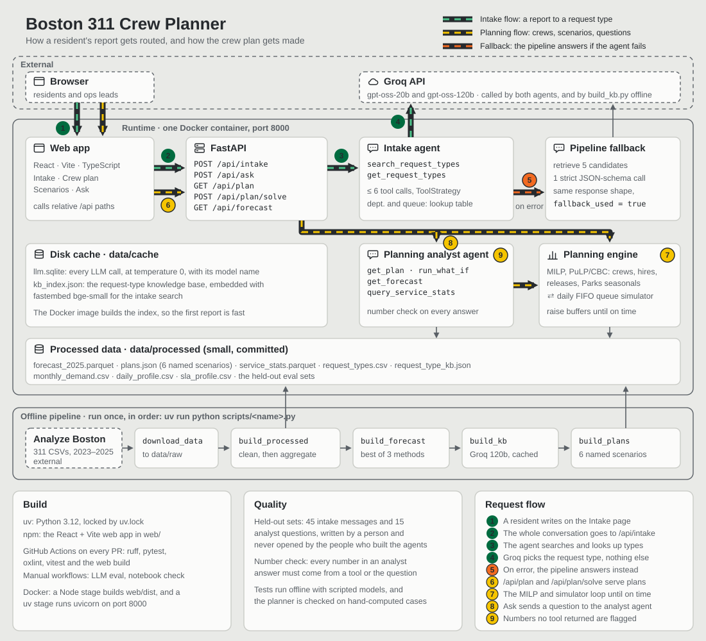

# Boston 311 Crew Planner

A month-by-month 2025 staffing plan for four City of Boston departments, built from real 311 service request data, plus a GenAI intake assistant that routes a resident's plain-language report to the right request type and department queue.

IE 5374 Hackathon · Northeastern University · Team of 3

[](docs/architecture.md)

The diagram is explained in detail, with the key design decisions, in [docs/architecture.md](docs/architecture.md).

> **Status:** in progress. Evaluation results and each member's contributions will be added before submission.

## The problem

Boston 311 received 306,756 service requests in 2024. Demand is seasonal (Public Works peaks in August and September; Parks more than triples between January and June), and on-time performance varies widely by department. We decide how many field crews each of four departments should have in each month of 2025, trading crew cost against on-time service under the hiring, release and seasonal-crew rules below.

## Departments in scope

| Department | Code | 2024 requests | On time, 2024 | Crew capacity (requests/day) | Annual cost per crew | Crews, Jan 2025 |
|---|---|---|---|---|---|---|
| Public Works | PWDx | 157,610 | 90% | 12 | $130,000 | 50 |
| Transportation (parking & traffic) | BTDT | 81,447 | 50% | 15 | $110,000 | 18 |
| Parks & Recreation | PARK | 18,736 | 93% | 6 | $120,000 | 10 |
| Inspectional Services | ISD | 18,624 | 72% | 4 | $140,000 | 16 |

Request counts and on-time rates come from the real data. Crew capacities, costs and starting crew levels are planning assumptions set by the hackathon brief.

### Planning rules (from the brief)

- A crew works 21 days a month and closes up to its daily capacity each day.
- New crews need one month of hiring and training before they start.
- Releasing a crew needs one month's notice and costs 25% of its annual cost.
- Parks may add seasonal crews from April to October at 1.3× the monthly cost, with no training delay and no release cost.
- Each overdue request costs $20, and a request still open 30 days after its target date costs an extra $100.

## What we're building

1. **Demand forecast:** monthly 2025 requests per department from 2023–2024 data, backtested and checked against January–September 2025 actuals.
2. **Staffing optimizer:** a mixed-integer model that sets crews, hires, releases and Parks seasonal crews for each month.
3. **Queue simulator:** replays a year of requests day by day to measure the on-time rate and overdue cost of any plan.
4. **Sensitivity analysis:** demand 20% above and below forecast, a snowstorm and a heat wave, each tested with a re-optimized plan and with the base plan held fixed.
5. **311 intake assistant:** retrieves the closest real request types for a resident's message and returns type, department and queue as structured output, asking a follow-up question when the message is unclear. Accuracy is measured on a hand-written test set.
6. **Web app:** a React + Vite + TypeScript app with four screens (intake, crew plan, scenarios and "ask the plan"), served by a FastAPI backend.

## The two agents

Both agents run on Groq's gpt-oss through LangChain's `create_agent`. Their tools are read-only Python functions that return compact JSON, and each run is capped at 6 tool calls. Every LLM call runs at temperature 0 and is cached to disk.

**Intake agent** (`/api/intake`, the Intake page) turns a resident's message into filed requests.
- **Splits and searches:** it splits the message into problems and searches the request-type knowledge base for each one (`search_request_types`, local fastembed embeddings).
- **Looks up details:** department, crew needs and 2024 closing times (`get_request_types`).
- **Answers or asks:** it answers with one request per problem, or asks one follow-up question.
- **The model picks the request type only.** Department, queue and typical days to close come from the lookup table, so they can't be invented.
- **Falls back:** if the agent fails, a simpler pipeline answers instead. It retrieves 5 candidates, makes one strict JSON-schema call limited to them, and the response says `fallback_used`.

**Planning analyst agent** (`/api/ask`, the Ask page) answers questions about the plan, the forecast and the 311 history. Its tools:
- **`get_plan`:** the precomputed named plans;
- **`run_what_if`:** re-solves the plan live. It reports `target_met`, which is true only when every department reaches the on-time target;
- **`get_forecast`;**
- **`query_service_stats`:** DuckDB over the 2023–2024 requests.

**Every number in an answer must come from a tool result or from the question.** The server's number check flags the rest, and the Ask page underlines them. A what-if answer links to the Scenarios page with the same settings.

The planning engine behind `/api/plan`, `/api/plan/solve` and the analyst's tools:
- **A MILP** (PuLP with CBC) chooses crews, hires, releases and Parks seasonal crews for each month.
- **A daily simulator** scores the plan: first in, first out, weekday crews, requests every day.
- **They loop:** capacity buffers rise in the months that miss the on-time target until each department meets it.

## Data

Public 311 service requests from [Analyze Boston](https://data.boston.gov/dataset/311-service-requests): the 2023 and 2024 files for modeling and the 2025 file for validation. The raw CSVs are too large for GitHub and are **not committed**; `scripts/download_data.py` fetches them into `data/raw/`. Only the small processed files the app needs are committed, in `data/processed/`.

## Tech stack

- **Backend:** Python 3.12, uv, FastAPI, Pydantic, DuckDB, pandas, PuLP with CBC, statsmodels.
- **GenAI:** LangChain (`langchain-groq`) on Groq's gpt-oss, and fastembed for local embeddings.
- **Tests and lint:** pytest and ruff.
- **Frontend:** React, Vite, TypeScript, Tailwind CSS v4, TanStack Query, React Router, oxlint and vitest.
- **CI:** GitHub Actions. Deployment is one Docker container.

## Getting started

You need [uv](https://docs.astral.sh/uv/) and Node 26 with npm. Docker is optional.

### 1. Configure

```bash
git clone https://github.com/nishanth3112/boston311-crew-planner.git
cd boston311-crew-planner
uv sync
cp .env.example .env    # then add your free GROQ_API_KEY from console.groq.com/keys
```

- **Agent pages need the key:** Intake (`/api/intake`) and Ask (`/api/ask`) return an error without it, or when Groq's free-tier rate limit is reached.
- **Plan pages don't:** Crew plan, Scenarios and the forecast work without it.

### 2. Run for development

Use two terminals:

```bash
uv run uvicorn boston311.api.main:app --reload    # API on http://localhost:8000
cd web && npm ci && npm run dev                    # app on http://localhost:5173
```

Open http://localhost:5173. Vite forwards `/api` requests to the API.

### 3. Or run with Docker

One container serves the API and the built web app:

```bash
docker build -t boston311 .
docker run --env-file .env -p 8000:8000 boston311
```

Open http://localhost:8000. The Groq key is passed when the container starts and is never built into the image.

### Tests

```bash
uv run pytest                            # no key or network needed
uv run ruff check . && uv run ruff format --check .
cd web && npm run lint && npm test && npm run build
```

### Evaluations

```bash
uv run python -m boston311.eval.intake_eval data/processed/intake_dev_set.csv
uv run python -m boston311.eval.analyst_eval data/processed/analyst_dev_set.csv
```

- **Model:** set `LLM_MODEL=openai/gpt-oss-120b` to evaluate with the larger model.
- **From GitHub:** run the **LLM eval** workflow from the Actions tab. It needs a `GROQ_API_KEY` repository secret.
- **Notebook check:** the **Notebook check** workflow confirms the submission notebook ran top to bottom with all its outputs.

### Rebuilding the data (optional)

The committed files in `data/processed/` are all the app needs. To rebuild them from the raw 311 data, run these in order:

```bash
uv run python scripts/download_data.py      # Analyze Boston CSVs into data/raw/
uv run python scripts/build_processed.py    # clean and aggregate into data/processed/
uv run python scripts/build_forecast.py     # backtest and write forecast_2025.parquet
uv run python scripts/build_kb.py           # request-type knowledge base (needs the Groq key)
uv run python scripts/build_plans.py        # the six named plans in plans.json
```

## How we work

- `main` is protected: every change goes through a pull request, gets one approving review from a teammate, and is squash-merged.
- Branch names are short and plain, one per ticket, such as `backend-setup` or `intake-agent`.
- Raw data, `.env` files and API keys are never committed.

## Team

| Member | GitHub | Focus |
|---|---|---|
| Nishanth Manoharan | [@nishanth3112](https://github.com/nishanth3112) | to be assigned |
| Ramgopal Reddy Alumalla | [@ramg-0903](https://github.com/ramg-0903) | to be assigned |
| Aryan Patil | [@Aryan16d](https://github.com/Aryan16d) | to be assigned |

Each member's contributions will be listed here before submission.
