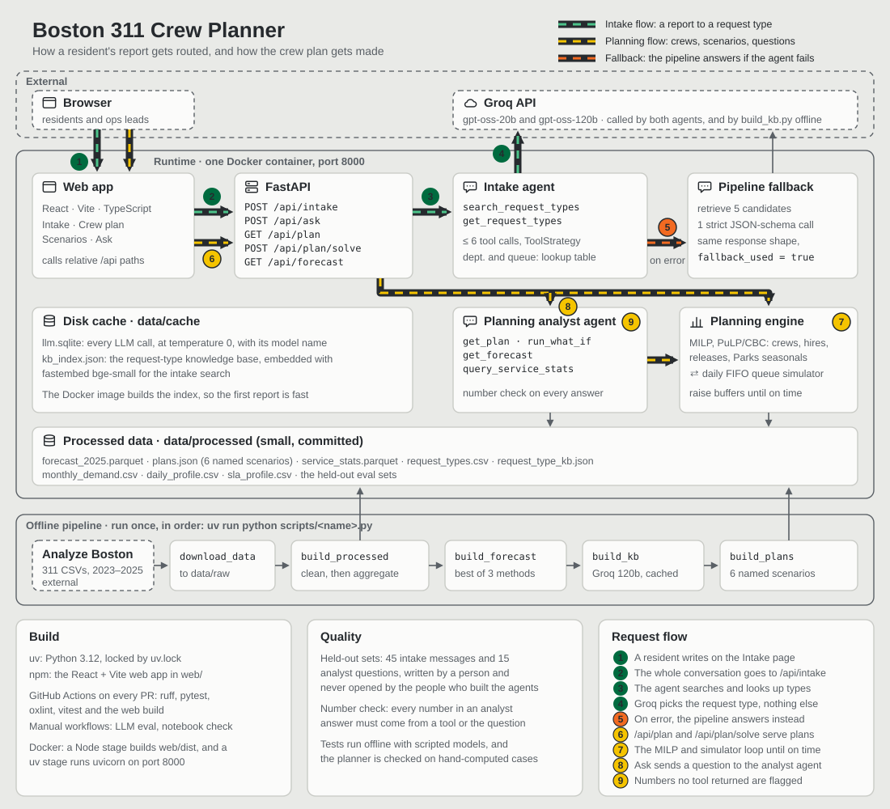
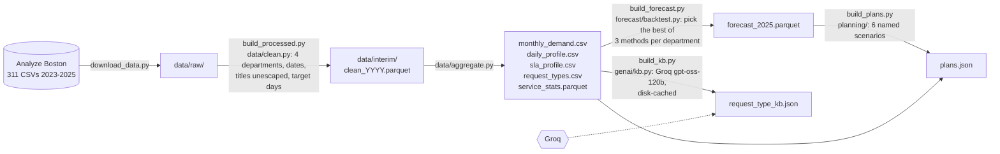
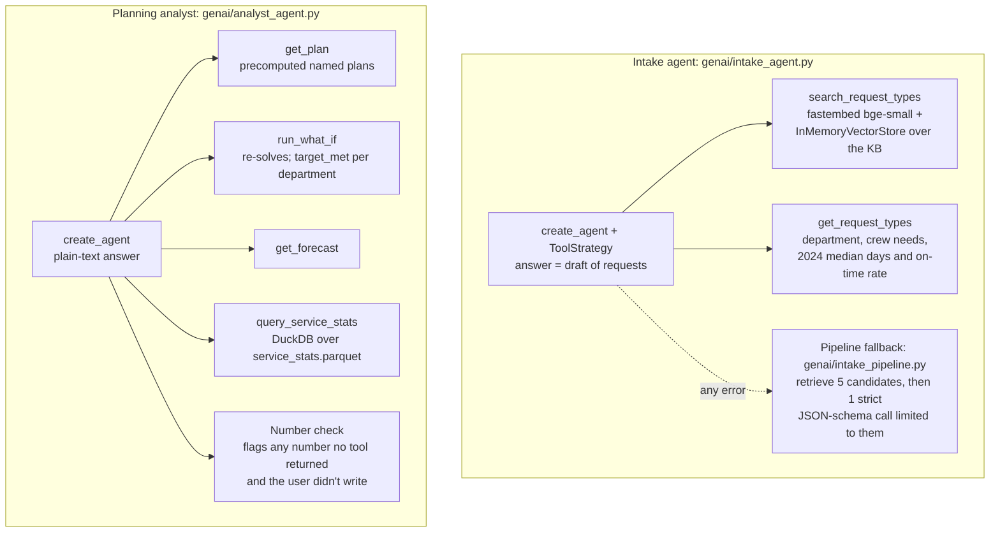
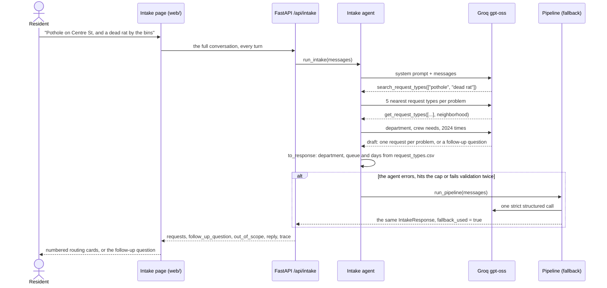
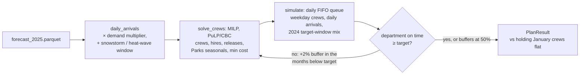
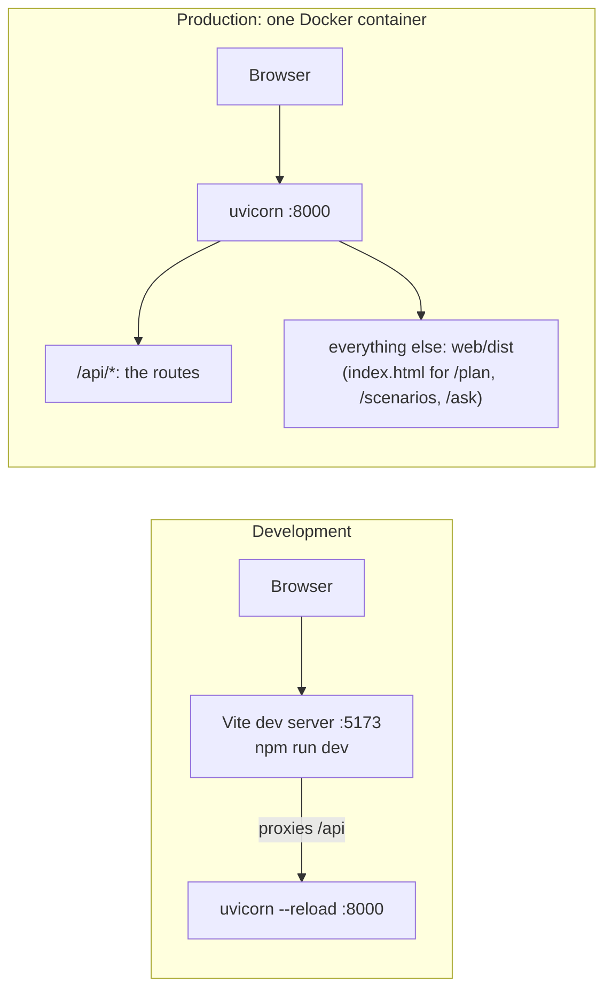

# Architecture

The overview above shows the whole system. This page breaks it into five detail diagrams, then lists the key decisions and where each one lives in the code.

1. [Offline pipeline](#1-offline-pipeline): raw 311 files to the small processed files the app reads
2. [The two agents and their tools](#2-the-two-agents-and-their-tools)
3. [How a report is routed](#3-how-a-report-is-routed)
4. [The plan loop](#4-the-plan-loop): optimizer and simulator
5. [Development and production](#5-development-and-production)
6. [Key decisions](#6-key-decisions)

All the logic is in `src/boston311/`. The notebook, the scripts and the API only import it and call it.

## 1. Offline pipeline

Each script is run once by hand. Only the small files in `data/processed/` are committed; `data/raw/`, `data/interim/` and `data/cache/` stay local.

The forecast is backtested by training through June 2024 and predicting July to December 2024. It is then checked against the January to September 2025 actuals.

## 2. The two agents and their tools

Both agents are LangChain `create_agent` agents on Groq's gpt-oss. Their tools are read-only Python functions that return compact JSON, and each run is capped at 6 tool calls. Both agents use a retry-with-hint middleware for Groq's malformed tool calls. Every LLM call runs at temperature 0, is cached to `data/cache/llm.sqlite`, and records the model name.

| | Intake | Planning analyst |
|---|---|---|
| Route | `POST /api/intake` | `POST /api/ask` |
| Answer | structured draft, through `ToolStrategy` | plain text |
| What the LLM picks | the request type only | which tools to call; the wording |
| What the server fills in | department, queue and typical days, from `request_types.csv` | `trace`, `what_if`, `unverified_numbers` |
| If it fails | the pipeline answers, and `fallback_used` is set | past the 6-call cap, a clear message; other errors return a 500, which the Ask page explains |

## 3. How a report is routed

## 4. The plan loop

`solve_plan` (`planning/optimizer.py`) runs this loop for each department independently. The named scenarios are precomputed into `data/processed/plans.json` by `scripts/build_plans.py`, so `/api/plan` answers instantly. `/api/plan/solve` and the analyst's `run_what_if` run the loop live, taking under 1 s for the base settings.

Timing rules in the MILP (working assumption 2):
- A hire is paid in month t, for training, and works from t+1.
- A release works t, is gone from t+1, and its fee (25% of annual cost) is charged in t.
- January crews are fixed.
- The crews left after December must cover January's forecast.

## 5. Development and production

The web app calls relative `/api/...` paths only, so there is no API URL setting and no CORS configuration. The Dockerfile has two stages:
1. **Node** builds `web/dist`.
2. **Python 3.12 with uv** installs the app, copies `data/processed/` and the built web app, and pre-builds the intake search index.

The Groq key is passed at run time (`--env-file .env`) and never built into the image.

## 6. Key decisions

| Decision | Why | Where |
|---|---|---|
| Workload is every request in the four departments | It matches the brief's counts. "Actionable only" is a sensitivity run, not the base case. | `data/clean.py` |
| Hire paid in t, works t+1; release works t, fee in t | The brief's one-month training and notice | `planning/optimizer.py` `solve_crews` |
| Requests with no target date are workload but not in on-time % | About 16% have no target; counting them as on time would inflate the rate | `planning/simulator.py` `simulate` |
| Crews work weekdays; requests arrive every day; FIFO queue | It matches how 311 actually runs. Earliest-due-date stays a possible policy lever. | `planning/simulator.py` |
| Reported on-time % and cost come from the simulator | The MILP's capacity constraint is only a proxy | `planning/optimizer.py` `solve_plan` |
| December crews must cover January | Stops the plan from shedding crews at the end of the horizon | `solve_crews` |
| Deterministic fluid simulator | Results repeat exactly, and tests check hand-computed answers | `planning/simulator.py` |
| On-time target per department, buffers raised only in months below it | One shared buffer let the fixed January crews or a one-week shock overstaff the whole year | `planning/optimizer.py` `plan_department` |
| Scenarios are re-optimized; shocks are stylized constants | 2023–24 had no clean snowstorm or heat wave to replay | `planning/simulator.py` `SHOCKS` |
| `pulp[cbc]` | PuLP 4.2 no longer bundles a solver | `pyproject.toml` |
| The LLM picks the request type only | Department and queue come from the lookup table, so they can't be invented | `genai/intake_pipeline.py` `to_response` |
| Pipeline: strict JSON schema limited to retrieved candidates; agent: a validator | A 158-name enum would add about 1,200 tokens to every agent call | `genai/intake_pipeline.py` `draft_schema` |
| Agent falls back to the pipeline on any error | Groq's gpt-oss sometimes misnames tools or breaks JSON | `genai/intake_agent.py` `run_intake_with_stats` |
| Analyst numbers must come from a tool result | The number check flags the rest, and the Ask page underlines them | `genai/analyst_agent.py` `unverified_numbers` |
| `target_met` is checked per department | The plan-wide rate can pass while departments miss | `genai/analyst_agent.py` `run_what_if` |
| In-memory vector index, local embeddings | 158 request types need no vector database or embedding API | `genai/retriever.py` |
| Held-out test sets are never opened by their builders | They stay honest | `data/processed/*_test_set.csv`, `reports/eval/` |
